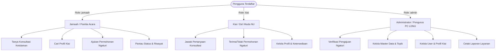
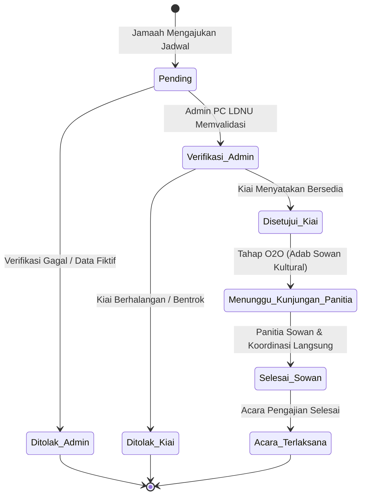
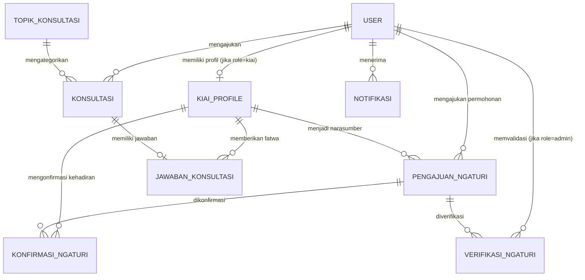
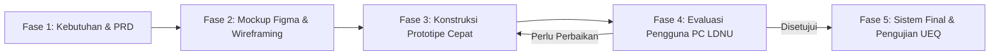

# PRODUCT REQUIREMENT DOCUMENT (PRD)
## Sistem Informasi Layanan Konsultasi Keislaman & Penjadwalan Kiai (DAIDANU)
**Mitra/Kasus:** Pimpinan Cabang Lembaga Dakwah Nahdlatul Ulama (PC LDNU) Kabupaten Kebumen  
**Model Pengembangan:** Prototyping SDLC  
**Versi Dokumen:** 1.0 (Fase Inisiasi & Perencanaan Prototipe)  
**Tanggal:** 23 September 2026  
**Status:** Draf Perencanaan Disetujui untuk Eksekusi Prototipe  

---

## 1. Ringkasan Eksekutif & Ikhtisar Produk (Executive Summary)

### 1.1 Latar Belakang
Layanan konsultasi keislaman dan permohonan mengundang (*ngaturi*) dai/kiai di lingkungan Nahdlatul Ulama (khususnya di Kabupaten Kebumen) saat ini masih berjalan secara konvensional, informal, dan terfragmentasi (melalui pesan pribadi WhatsApp, panggilan telepon, atau kunjungan langsung). Hal ini menimbulkan berbagai kendala mendasar:
1. **Kendala Komunikasi & Akses:** Kiai sering tidak merespons nomor asing/tidak dikenal karena tidak adanya wadah resmi sebagai gerbang verifikasi. Masyarakat yang tidak memiliki relasi pribadi kesulitan berkonsultasi.
2. **Ketiadaan Rekam Konsultasi Terstruktur:** Tanya-jawab via media sosial umum sulit didokumentasikan, rentan hilang, dan tidak dapat dijadikan arsip rujukan keagamaan yang valid.
3. **Jadwal Acara Tumpang Tindih (*Bentrok*):** Proses *ngaturi* kiai belum terpusat, menyebabkan kesulitan koordinasi jadwal antara panitia acara, admin LDNU, dan kiai/dai muda yang bersangkutan.
4. **Kebutuhan Menjaga Adab Kultural NU:** Digitalisasi dakwah tidak boleh menghilangkan tradisi luhur *sowan* (silaturahim langsung ke kediaman kiai).

### 1.2 Solusi: Platform DAIDANU
**DAIDANU (Da'i Muda Nahdlatul Ulama)** adalah platform sistem informasi berbasis web yang mengintegrasikan:
- **Layanan Konsultasi Keislaman Daring 2 Arah:** Terstruktur berdasarkan topik fikih/keislaman dan dijawab langsung oleh kiai/dai muda kompeten berpaham *Ahlussunnah wal Jama'ah an-Nahdliyyah*.
- **Sistem Reservasi & Penjadwalan (*Ngaturi*) Kiai dengan Model Online-to-Offline (O2O):** Pengajuan dan validasi tanggal dilakukan digital melalui sistem, dan diakhiri dengan mekanisme silaturahim langsung melalui status *"Menunggu Kunjungan Panitia"* untuk menjaga adab sowan.
- **Direktori & Manajemen Profil Kiai:** Portofolio keilmuan, bidang keahlian, dan ketersediaan dai muda NU di Kabupaten Kebumen.
- **Pusat Tata Kelola & Validasi PC LDNU:** Dashboard administratif untuk mengelola pengguna, topik, moderasi fatwa, serta verifikasi kelayakan acara.

---

## 2. Visi Produk, Tujuan & Metrik Keberhasilan

### 2.1 Visi Produk
Menjadi ekosistem digital layanan keagamaan Nahdlatul Ulama yang terpercaya, modern, dan inklusif di tingkat cabang/daerah, yang mempercepat akses fatwa serta koordinasi dakwah tanpa mengorbankan adab dan tradisi kultural pesantren.

### 2.2 Tujuan Pengembangan (Goals)
1. **Membangun Prototipe Fungsional:** Mengembangkan sistem web DAIDANU dengan arsitektur MVC (Laravel), UI responsif (Tailwind CSS), dan basis data terpusat (MySQL).
2. **Menerapkan Model O2O Kultural:** Menggabungkan otomasi administrasi digital dengan tradisi sowan fisik dalam alur *ngaturi* kiai.
3. **Evaluasi Pengalaman Pengguna (UX):** Menguji penerimaan prototipe kepada pengurus LDNU, kiai, dan jamaah menggunakan *User Experience Questionnaire* (UEQ) serta memastikan stabilitas via *Black Box Testing*.

### 2.3 Metrik Keberhasilan (Success Metrics)
| Aspek | Indikator Kinerja Utama (KPI) | Target Prototipe |
|---|---|---|
| **Fungsionalitas** | Hasil Black Box Testing | 100% skenario uji lulus (*Pass*) |
| **Penerimaan Pengguna** | Skor UEQ (6 Skala: Attractiveness, Perspicuity, Efficiency, Dependability, Stimulation, Novelty) | Kategori minimal **Good** (di atas rata-rata benchmark global) |
| **Efisiensi Alur Ngaturi** | Waktu pemrosesan validasi & konfirmasi | < 48 jam dari permohonan dibuat hingga status konfirmasi |
| **Aksesibilitas** | Responsivitas tampilan peramban | Berjalan mulus di Desktop, Tablet, dan Ponsel Pintar |

---

## 3. Profil Pengguna & Matriks Hak Akses (User Personas & Role Matrix)

Sistem membedakan hak akses dan tanggung jawab menjadi 3 peran (*actors*):



### 3.1 Matriks Fitur Berdasarkan Peran
| Fitur / Modul | Jamaah (Masyarakat) | Kiai (Narasumber) | Admin (PC LDNU) | Tamu (Guest) |
|---|:---:|:---:|:---:|:---:|
| Melihat Beranda & Profil Singkat Kiai | ✅ | ✅ | ✅ | ✅ |
| Registrasi Akun Mandiri | ✅ | ❌ (Didata Admin/Kemitraan) | ❌ (Internal) | ✅ |
| Login / Logout / Ubah Password | ✅ | ✅ | ✅ | ❌ |
| Eksplorasi Direktori Profil Lengkap Kiai | ✅ | ✅ | ✅ | ✅ |
| Mengajukan Pertanyaan Konsultasi | ✅ | ❌ | ❌ | ❌ |
| Menjawab Konsultasi Keislaman | ❌ | ✅ | ❌ (Review/Moderasi) | ❌ |
| Melihat Riwayat Konsultasi Pribadi | ✅ | ❌ | ❌ | ❌ |
| Mengajukan Jadwal *Ngaturi* Kiai | ✅ | ❌ | ❌ | ❌ |
| Verifikasi Kelayakan Berkas *Ngaturi* | ❌ | ❌ | ✅ | ❌ |
| Konfirmasi Ketersediaan *Ngaturi* | ❌ | ✅ | ❌ | ❌ |
| Pantau Status *Ngaturi* (Alur O2O) | ✅ | ✅ | ✅ | ❌ |
| Notifikasi Aktivitas Sistem | ✅ | ✅ | ✅ | ❌ |
| Kelola Akun Pengguna & Profil Kiai | ❌ | Khusus Profil Sendiri | ✅ (Semua) | ❌ |
| Kelola Master Topik Konsultasi | ❌ | ❌ | ✅ | ❌ |
| Cetak Laporan Operasional (PDF/Excel) | ❌ | ❌ | ✅ | ❌ |

---

## 4. Ruang Lingkup Sistem (Scope of System)

### 4.1 Dalam Lingkup (In-Scope)
1. **Modul Autentikasi & Akun:** Registrasi jamaah, login berdasar role (`jamaah`, `kiai`, `admin`), enkripsi kata sandi (Bcrypt), manajemen profil dasar dan foto.
2. **Modul Profil Kiai:** Informasi keilmuan, riwayat pesantren, spesialisasi cabang fikih/ilmu agama, status keaktifan.
3. **Modul Konsultasi Keislaman (Tanya-Jawab 2 Arah):** Pemilihan topik konsultasi, formulir pertanyaan, antrean pertanyaan masuk bagi kiai, formulir jawaban fikih berdalil, arsip riwayat konsultasi.
4. **Modul Penjadwalan (*Ngaturi*) Kiai dengan Model O2O:**
   - Formulir pengajuan (nama acara, tanggal & jam, lokasi, deskripsi permohonan).
   - Validasi administratif 1 arah oleh Admin PC LDNU (memastikan panitia jelas dan bukan acara fiktif).
   - Konfirmasi kehadiran oleh Kiai (bersedia / berhalangan).
   - Transisi status O2O: *"Menunggu Kunjungan Panitia"* untuk prosesi sowan langsung menyerahkan undangan fisik/tuntunan adab.
5. **Modul Notifikasi Dalam Sistem:** Peringatan pembaruan status konsultasi dan perkembangan izin acara.
6. **Modul Dashboard & Pelaporan Admin:** Ringkasan statistik, filter tanggal permohonan, cetak laporan rekapitulasi keagamaan.

### 4.2 Luar Lingkup (Out-of-Scope)
1. Aplikasi native Android/iOS (fokus sistem adalah web responsif mobile-friendly).
2. Sistem pembayaran / transfer uang muka (*bisyarah*) narasumber (tidak ada transaksi finansial daring; adab silaturahim dilakukan langsung di dunia nyata).
3. Chat real-time instan WebSocket (digantikan dengan sistem tanya-jawab asinkronus berstatus untuk menjamin kiai memiliki waktu mengkaji referensi kitab sebelum menjawab).
4. Integrasi dakwah di luar naungan dan kultur jam'iyyah Nahdlatul Ulama.

---

## 5. Alur Kerja & Arsitektur Logika Sistem (System Workflows)

### 5.1 Alur Logika Inovasi: Online-to-Offline (O2O) "Ngaturi Kiai"
Inovasi kultural pada DAIDANU menerapkan siklus 4 tahap status:



**Penjelasan Status Alur:**
1. **`pending`**: Permohonan masuk dari panitia/jamaah ke sistem.
2. **`verifikasi_admin` (Admin LDNU)**: Admin memeriksa kelayakan, lokasi, dan memastikan pengajuan bukan spam/fiktif. Jika valid, diteruskan ke dashboard kiai terkait.
3. **`disetujui_kiai` / `ditolak` (Kiai)**: Kiai memeriksa kalender kegiatannya. Jika menyetujui, status berubah menjadi disetujui.
4. **Status Khusus: `menunggu_kunjungan_panitia` (Tradisi Sowan)**: Sistem memberikan surat rekomendasi/pengantar digital dan instruksi bagi panitia untuk melakukan sowan langsung ke ndalem/kediaman kiai dengan tata krama NU.

### 5.2 Alur Konsultasi Keislaman
1. Jamaah memilih kategori topik (misal: Fikih Ibadah, Fikih Muamalah, Munakahat).
2. Jamaah menginput judul dan deskripsi pertanyaan (Status: `menunggu`).
3. Sistem mendistribusikan pertanyaan ke ruang konsultasi Kiai yang sesuai dengan bidang keahliannya.
4. Kiai menelaah rujukan/kitab kuning, lalu menginput teks jawaban/fatwa (Status: `dijawab`).
5. Jamaah menerima notifikasi dalam sistem dan dapat membaca fatwa serta mencetaknya bila diperlukan.

---

## 6. Spesifikasi Kebutuhan Fungsional Rinci (Functional Requirements)

### Modul 1: Autentikasi & Manajemen Sesi (AUTH)
- **FR-AUTH-01:** Sistem harus menyediakan formulir registrasi mandiri untuk peran Jamaah dengan validasi nama, email unik, no HP/WhatsApp, dan kata sandi (minimal 8 karakter).
- **FR-AUTH-02:** Sistem harus mengenkripsi kata sandi pengguna sebelum disimpan ke basis data menggunakan hashing standar industri (Bcrypt).
- **FR-AUTH-03:** Sistem harus mengautentikasi pengguna berdasarkan kombinasi email dan password serta mengalihkan ke dashboard sesuai perannya (`jamaah`, `kiai`, atau `admin`).
- **FR-AUTH-04:** Sistem harus membatasi akses antarmuka melalui middleware otorisasi (RBAC). Pengguna yang belum terautentikasi atau tidak berhak akan diarahkan ke halaman login atau pesan akses dilarang (403).
- **FR-AUTH-05:** Sistem harus menyediakan fungsi logout aman yang menghapus sesi aktif.

### Modul 2: Direktori & Profil Kiai (KIAI)
- **FR-KIAI-01:** Sistem harus menampilkan katalog da'i/kiai muda NU yang terverifikasi di LDNU Kebumen, dilengkapi filter bidang keahlian dan pencarian nama.
- **FR-KIAI-02:** Halaman profil kiai harus menyajikan nama lengkap beserta gelar, foto profil, bidang keahlian/spesialisasi fikih, biografi/riwayat pesantren, dan status ketersediaan.
- **FR-KIAI-03:** Kiai yang login dapat memperbarui biografi, spesialisasi keilmuan, dan status keaktifan melalui dashboard pribadi.

### Modul 3: Layanan Konsultasi Keislaman (KONSULTASI)
- **FR-KON-01:** Jamaah yang telah login dapat membuat tiket konsultasi baru dengan memilih master topik, mengisi judul permasalahan, dan uraian pertanyaan.
- **FR-KON-02:** Sistem mencatat waktu kirim dan menetapkan status awal pertanyaan sebagai `menunggu`.
- **FR-KON-03:** Kiai dapat melihat antrean pertanyaan konsultasi yang masuk, membaca isi pertanyaan, dan menyusun jawaban bimbingan.
- **FR-KON-04:** Ketika Kiai mengirim jawaban, sistem menyimpan data jawaban, mencatat ID kiai yang menjawab, waktu jawab, dan memperbarui status konsultasi menjadi `dijawab`.
- **FR-KON-05:** Jamaah dapat melihat riwayat daftar pertanyaan yang diajukan beserta jawaban yang diberikan oleh kiai.
- **FR-KON-06:** Admin memiliki akses untuk memantau seluruh lalu lintas konsultasi dan menutup (*close*) pertanyaan yang melanggar norma atau tidak relevan.

### Modul 4: Sistem Penjadwalan Ngaturi Kiai Berbasis O2O (NGATURI)
- **FR-NGA-01:** Jamaah/panitia dapat mengajukan permohonan pengundangan kiai dengan mengisi formulir: pemilihan kiai yang dituju, nama acara keagamaan, tanggal dan jam kegiatan, alamat/lokasi lengkap acara, serta catatan/keterangan kegiatan.
- **FR-NGA-02:** Sistem mencatat pengajuan baru dengan status `pending` dan mengirimkan notifikasi tugas peninjauan ke Admin PC LDNU.
- **FR-NGA-03:** Admin PC LDNU dapat memeriksa detail pengajuan ngaturi dan memberikan keputusan verifikasi:
  - Jika **Valid**: Status diubah menjadi `verifikasi_admin` (diteruskan ke kiai).
  - Jika **Tidak Valid / Fiktif**: Status diubah menjadi `ditolak` disertai catatan perbaikan dari admin.
- **FR-NGA-04:** Kiai dapat melihat daftar pengajuan yang telah lolos verifikasi admin, memeriksa detail acara dan tanggal, kemudian memberikan keputusan:
  - Jika **Bersedia**: Sistem memperbarui status pengajuan menjadi `disetujui_kiai`, lalu memicu status O2O *"Menunggu Kunjungan Panitia"*.
  - Jika **Tidak Bersedia**: Sistem memperbarui status menjadi `ditolak` dengan alasan berhalangan.
- **FR-NGA-05:** Sistem menghasilkan ringkasan bukti pengajuan/rekomendasi digital yang dapat diunduh/dicetak panitia sebagai bekal administrasi saat melakukan *sowan* fisik ke kediaman kiai.

### Modul 5: Notifikasi & Komunikasi Sistem (NOTIF)
- **FR-NOT-01:** Sistem menghasilkan notifikasi otomatis kepada Jamaah saat status konsultasinya telah dijawab.
- **FR-NOT-02:** Sistem menghasilkan notifikasi otomatis kepada Jamaah dan Kiai saat terdapat permohonan ngaturi baru, verifikasi admin, maupun konfirmasi akhir kiai.
- **FR-NOT-03:** Pengguna dapat melihat daftar notifikasi dan menandai notifikasi sebagai sudah dibaca (`dibaca`).

### Modul 6: Tata Kelola Administrator & Pelaporan (ADMIN)
- **FR-ADM-01:** Admin dapat mengelola master topik konsultasi keislaman (Tambah, Ubah, Hapus data topik).
- **FR-ADM-02:** Admin dapat mengelola data master pengguna (aktivasi kiai, penambahan akun kiai, pengelolaan akun jamaah).
- **FR-ADM-03:** Admin dapat melihat kalender ketersediaan dan jadwal kegiatan seluruh kiai terdaftar untuk mencegah konflik jadwal di wilayah Kebumen.
- **FR-ADM-04:** Admin dapat memfilter dan mengekspor/mencetak rekapitulasi laporan layanan konsultasi dan permohonan ngaturi dalam rentang waktu tertentu.

---

## 7. Spesifikasi Kebutuhan Non-Fungsional (Non-Functional Requirements)

| Kategori | Parameter | Spesifikasi |
|---|---|---|
| **Kesesuaian Budaya** | Adab & Tradisi O2O | Alur sistem wajib mempertahankan tahapan silaturahim fisik (*sowan*), tidak memutus hubungan tatap muka antara umat dan kiai. |
| **Kinerja & Responsivitas** | Response Time | Halaman sistem termuat dalam waktu < 2.5 detik pada koneksi internet standar (3G/4G). |
| **Keamanan** | Keamanan Data & Sesi | 1. Sandi pengguna di-hash dengan algoritma Bcrypt.<br>2. Proteksi terhadap SQL Injection melalui Laravel Eloquent ORM parameterized queries.<br>3. Proteksi CSRF (Cross-Site Request Forgery) pada seluruh formulir.<br>4. Sanitasi input XSS pada formulir konsultasi dan jawaban. |
| **Ketersediaan** | Availability | Layanan web dapat diakses secara kontinu 24/7. |
| **Kompatibilitas** | Cross-Browser | Berfungsi optimal tanpa cacat antarmuka pada Google Chrome, Mozilla Firefox, Microsoft Edge, Safari, dan Mobile Webview. |
| **Aksesibilitas UI** | Desain Antarmuka | Tata letak responsif (*mobile-first*), tipografi jelas dengan kontras warna hijau NU (#1B5E20 / #2E7D32) yang ramah mata dan elegan. |

---

## 8. Desain Arsitektur Data & Kamus Basis Data

Arsitektur basis data relasional dirancang ternormalisasi hingga 3NF (Third Normal Form) untuk menjamin integritas data:



### Kamus Data Entitas Fisik

#### 1. Tabel `users`
| Field | Tipe Data | Keterangan / Batasan |
|---|---|---|
| `id_user` | INT(11) AUTO_INCREMENT | PK |
| `nama` | VARCHAR(100) | Nama lengkap pengguna |
| `email` | VARCHAR(100) | Email aktif, UNIQUE |
| `password` | VARCHAR(255) | Hash Bcrypt |
| `role` | ENUM('jamaah','kiai','admin') | Peran dalam sistem |
| `no_hp` | VARCHAR(20) | Kontak WhatsApp / Telepon aktif |
| `foto_profile` | VARCHAR(255) | Path penyimpanan file foto (nullable) |
| `created_at` | TIMESTAMP / DATETIME | Waktu pendaftaran |
| `updated_at` | TIMESTAMP / DATETIME | Waktu pembaruan profil |

#### 2. Tabel `kiai_profiles`
| Field | Tipe Data | Keterangan / Batasan |
|---|---|---|
| `id_kiai` | INT(11) AUTO_INCREMENT | PK |
| `id_user` | INT(11) | FK -> `users.id_user` (Unique 1:1) |
| `nama_kiai` | VARCHAR(100) | Nama lengkap beserta gelar kiai |
| `bidang_keahlian` | VARCHAR(150) | Spesialisasi keilmuan (contoh: Fikih, Tafsir, Tasawuf) |
| `bio` | TEXT | Riwayat pendidikan & kepesantrenan |
| `foto` | VARCHAR(255) | Path foto resmi kiai |
| `status_aktif` | ENUM('aktif','nonaktif') | Status ketersediaan menerima permohonan |

#### 3. Tabel `topik_konsultasi`
| Field | Tipe Data | Keterangan / Batasan |
|---|---|---|
| `id_topik` | INT(11) AUTO_INCREMENT | PK |
| `nama_topik` | VARCHAR(100) | Contoh: Fikih Ibadah, Fikih Muamalah, Munakahat |
| `deskripsi` | TEXT | Penjelasan cakupan bahasan topik |

#### 4. Tabel `konsultasi`
| Field | Tipe Data | Keterangan / Batasan |
|---|---|---|
| `id_konsultasi` | INT(11) AUTO_INCREMENT | PK |
| `id_user` | INT(11) | FK -> `users.id_user` (Pemohon/Jamaah) |
| `id_topik` | INT(11) | FK -> `topik_konsultasi.id_topik` |
| `judul` | VARCHAR(150) | Ringkasan pokok masalah |
| `pertanyaan` | TEXT | Uraian masalah keagamaan yang ditanyakan |
| `tanggal_kirim` | DATETIME | Waktu pengiriman pertanyaan |
| `status` | ENUM('menunggu','dijawab','ditutup')| Status penanganan konsultasi |

#### 5. Tabel `jawaban_konsultasi`
| Field | Tipe Data | Keterangan / Batasan |
|---|---|---|
| `id_jawaban` | INT(11) AUTO_INCREMENT | PK |
| `id_konsultasi` | INT(11) | FK -> `konsultasi.id_konsultasi` |
| `id_kiai` | INT(11) | FK -> `kiai_profiles.id_kiai` |
| `jawaban` | TEXT | Uraian bimbingan, dalil, dan fatwa keislaman |
| `tanggal_jawab` | DATETIME | Waktu jawaban diselesaikan |

#### 6. Tabel `pengajuan_ngaturi`
| Field | Tipe Data | Keterangan / Batasan |
|---|---|---|
| `id_ngaturi` | INT(11) AUTO_INCREMENT | PK |
| `id_user` | INT(11) | FK -> `users.id_user` (Panitia/Jamaah) |
| `id_kiai` | INT(11) | FK -> `kiai_profiles.id_kiai` (Kiai yang dituju) |
| `nama_acara` | VARCHAR(150) | Contoh: Pengajian Akbar Peringatan Maulid Nabi |
| `lokasi` | VARCHAR(255) | Lokasi/alamat detail penyelenggaraan |
| `tanggal_acara` | DATETIME | Tanggal dan waktu pelaksanaan acara |
| `keterangan` | TEXT | Deskripsi teknis, tema ceramah, perkiraan jamaah |
| `status` | ENUM('pending','verifikasi_admin','disetujui_kiai','ditolak') | Status progres alur kerja |

#### 7. Tabel `verifikasi_ngaturi`
| Field | Tipe Data | Keterangan / Batasan |
|---|---|---|
| `id_verifikasi` | INT(11) AUTO_INCREMENT | PK |
| `id_ngaturi` | INT(11) | FK -> `pengajuan_ngaturi.id_ngaturi` |
| `id_admin` | INT(11) | FK -> `users.id_user` (Admin verifikator) |
| `status_verifikasi` | ENUM('diteruskan','ditolak')| Keputusan administratif admin |
| `catatan` | TEXT | Alasan / arahan perbaikan (bila ada) |
| `tanggal_verifikasi` | DATETIME | Waktu verifikasi dilakukan |

#### 8. Tabel `konfirmasi_ngaturi`
| Field | Tipe Data | Keterangan / Batasan |
|---|---|---|
| `id_konfirmasi` | INT(11) AUTO_INCREMENT | PK |
| `id_ngaturi` | INT(11) | FK -> `pengajuan_ngaturi.id_ngaturi` |
| `id_kiai` | INT(11) | FK -> `kiai_profiles.id_kiai` |
| `keputusan` | ENUM('bersedia','tidak_bersedia') | Konfirmasi akhir kiai |
| `catatan` | TEXT | Catatan khusus dari kiai untuk panitia |
| `tanggal_konfirmasi` | DATETIME | Waktu konfirmasi diberikan |

#### 9. Tabel `notifikasi`
| Field | Tipe Data | Keterangan / Batasan |
|---|---|---|
| `id_notifikasi` | INT(11) AUTO_INCREMENT | PK |
| `id_user` | INT(11) | FK -> `users.id_user` (Penerima notifikasi) |
| `judul` | VARCHAR(100) | Judul notifikasi |
| `pesan` | TEXT | Pesan ringkas notifikasi |
| `tipe` | VARCHAR(50) | 'konsultasi', 'ngaturi', 'sistem' |
| `status_baca` | ENUM('dibaca','belum_dibaca')| Status dibaca |
| `created_at` | DATETIME | Waktu notifikasi dibuat |

---

## 9. Struktur Antarmuka Pengguna & Peta Situs (Sitemap & UI Flow)

```
DAIDANU Web Platform
│
├── Area Publik (Tamu / Guest)
│   ├── Halaman Utama (Hero Banner, Pengenalan PC LDNU, Panduan O2O)
│   ├── Halaman Direktori Da'i / Kiai (Filter Keahlian & Pencarian)
│   ├── Detail Profil Kiai (Portofolio, Sanad/Bio, Tombol Konsultasi/Ngaturi)
│   ├── Halaman Tanya-Jawab Terbuka / FAQ Keagamaan
│   ├── Halaman Login
│   └── Halaman Registrasi Jamaah
│
├── Dashboard Jamaah
│   ├── Beranda Jamaah (Status Pengajuan Aktif & Notifikasi)
│   ├── Ruang Konsultasi (Form Buat Pertanyaan & Riwayat Jawaban Kiai)
│   ├── Layanan Ngaturi Kiai (Form Pengajuan Acara Baru)
│   ├── Pelacakan Status Ngaturi (Monitoring Progress O2O & Unduh Bukti Rekomendasi)
│   └── Pengaturan Profil & Kontak
│
├── Dashboard Kiai / Da'i Muda
│   ├── Beranda Kiai (Ringkasan Konsultasi Masuk & Jadwal Acara)
│   ├── Daftar Antrean Konsultasi (Form Input Fatwa / Jawaban)
│   ├── Permohonan Ngaturi Masuk (Detail Acara, Tombol 'Bersedia' / 'Tidak Bersedia')
│   ├── Kalender Jadwal Ceramah Saya
│   └── Kelola Portofolio & Status Ketersediaan
│
└── Dashboard Admin (PC LDNU Kebumen)
    ├── Beranda Ringkasan Statistik (Total Konsultasi, Ngaturi, Dai Aktif)
    ├── Moderasi Konsultasi Keislaman
    ├── Meja Verifikasi Ngaturi (Review Kelayakan Acara & Teruskan ke Kiai)
    ├── Manajemen Master Data Topik Konsultasi
    ├── Manajemen Pengguna & Verifikasi Profil Kiai
    └── Laporan & Cetak Rekapitulasi (PDF Rekap Layanan)
```

---

## 10. Rencana Rilis Prototipe & Tahapan Iterasi (Prototyping Roadmap)

Sesuai metodologi *Prototype* (Rosa & Shalahuddin, 2016), pengembangan dibagi ke dalam siklus iterasi:



### Timeline & Pembagian Kerja Prototipe:
- **Iterasi 1 (Minggu 1 - Perancangan Cepat & Arsitektur):**
  - Finalisasi PRD dan kamus data.
  - Setup proyek Laravel, Tailwind CSS, konfigurasi database MySQL, dan migrasi skema tabel.
  - Pembuatan seeder pengguna (Admin, Kiai, Jamaah) dan topik awal konsultasi.
- **Iterasi 2 (Minggu 2 - Fitur Inti Konsultasi & Direktori Kiai):**
  - Implementasi autentikasi & RBAC.
  - Halaman katalog profil Kiai.
  - Modul tanya-jawab konsultasi keislaman (input pertanyaan jamaah -> antrean kiai -> input jawaban).
- **Iterasi 3 (Minggu 3 - Fitur O2O Ngaturi Kiai & Notifikasi):**
  - Formulir permohonan ngaturi kiai.
  - Alur verifikasi admin PC LDNU.
  - Alur konfirmasi kiai (bersedia/tidak).
  - Tampilan kartu panduan sowan ("Menunggu Kunjungan Panitia").
  - Modul notifikasi dalam sistem.
- **Iterasi 4 (Minggu 4 - Manajemen Admin, Pelaporan & Evaluasi):**
  - Dashboard statistik admin & cetak laporan PDF.
  - Uji fungsi Black Box Testing.
  - Pengujian kuesioner UEQ kepada pengurus LDNU & calon pengguna jamaah.
  - Penyempurnaan akhir prototipe.

---

## 11. Rencana Pengujian & Validasi Kualitas

### 11.1 Black Box Testing (Pengujian Fungsional)
Setiap use case akan diuji masukan dan keluarannya:
1. **Skenario Autentikasi:** Validasi email duplikat, password salah, pembatasan akses halaman admin bagi jamaah.
2. **Skenario Konsultasi:** Pengiriman pertanyaan kosong, filter topik, penyimpanan fatwa jawaban kiai.
3. **Skenario Ngaturi Kiai O2O:** Pengajuan jadwal bentrok, verifikasi tolak oleh admin dengan catatan, konfirmasi kesediaan oleh kiai, transisi status sowan.
4. **Skenario Notifikasi:** Notifikasi muncul saat status pengajuan atau konsultasi berubah.

### 11.2 Evaluasi Pengalaman Pengguna (UEQ - User Experience Questionnaire)
Pengujian non-fungsional menggunakan instrumen UEQ dengan 26 butir pertanyaan skala 7 poin mencakup:
1. **Attractiveness (Daya Tarik):** Kesan visual dan kenyamanan tampilan.
2. **Perspicuity (Kejelasan):** Kemudahan memahami alur dan instruksi sistem.
3. **Efficiency (Efisiensi):** Kecepatan dan kepraktisan menyelesaikan pengajuan.
4. **Dependability (Keandalan):** Keamanan dan rasa percaya terhadap fatwa serta kepastian jadwal.
5. **Stimulation (Stimulasi):** Ketertarikan pengguna untuk terus menggunakan platform.
6. **Novelty (Kebaruan):** Keunikan inovasi digitalisasi O2O dalam ranah keagamaan NU.

---

## 12. Matriks Risiko & Mitigasi

| Potensi Risiko | Tingkat Dampak | Rencana Mitigasi |
|---|:---:|---|
| **Resistensi Tradisi:** Anggapan bahwa digitalisasi menghilangkan adab santri/sowan | Tinggi | Menekankan fitur O2O dengan status *"Menunggu Kunjungan Panitia"*, di mana sistem digital hanya berfungsi sebagai pra-konfirmasi dan tata kelola, sedangkan sowan fisik tetap diwajibkan. |
| **Keterlambatan Jawaban Kiai:** Kiai memiliki jadwal dakwah dan pesantren yang padat | Sedang | Sistem mendistribusikan konsultasi ke beberapa da'i muda sesuai bidang keahlian, dilengkapi dashboard notifikasi bagi kiai yang belum merespons > 3 hari. |
| **Permohonan Ngaturi Fiktif / Iseng:** Panitia palsu memesan jadwal kiai | Tinggi | Diterapkannya tahapan verifikasi wajib oleh Admin PC LDNU sebelum permohonan sampai ke kalender Kiai. |
| **Keamanan Data Pribadi Pengguna:** Data nomor telepon jamaah bocor | Sedang | Pembatasan akses nomor telepon hanya untuk panitia dan verifikator resmi PC LDNU demi keperluan sowan dan koordinasi acara. |
